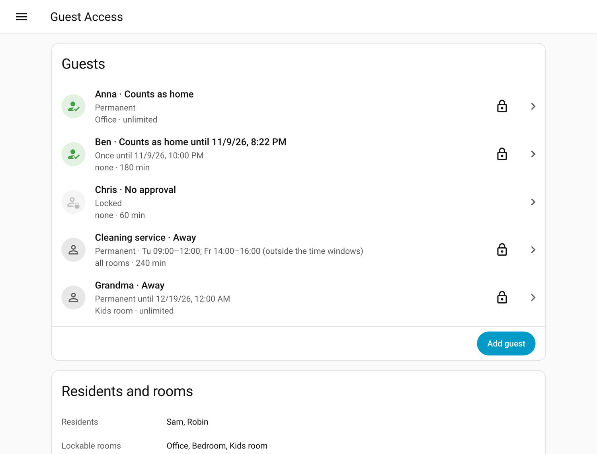
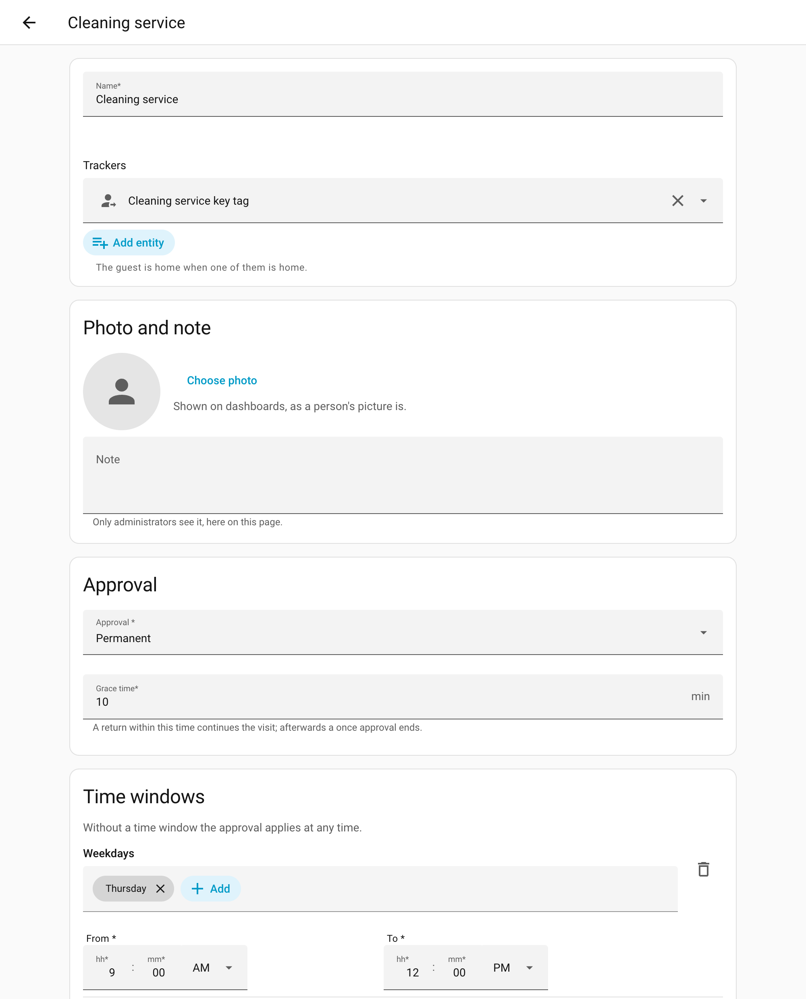
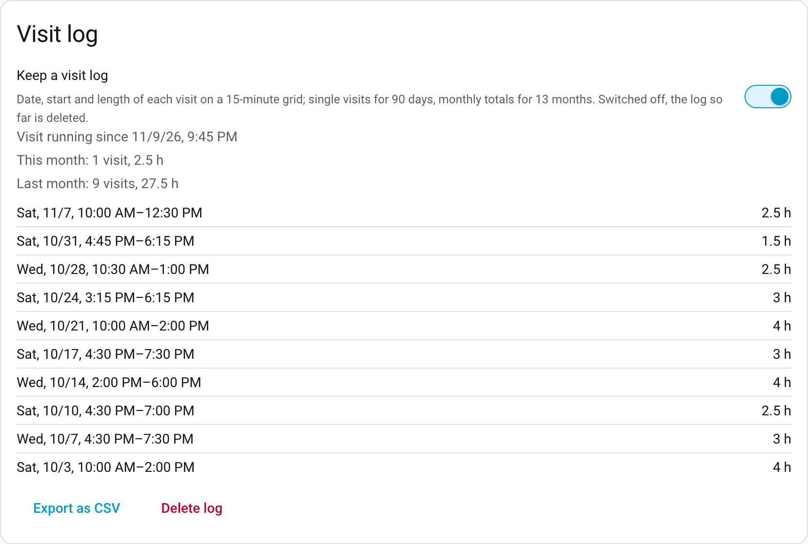
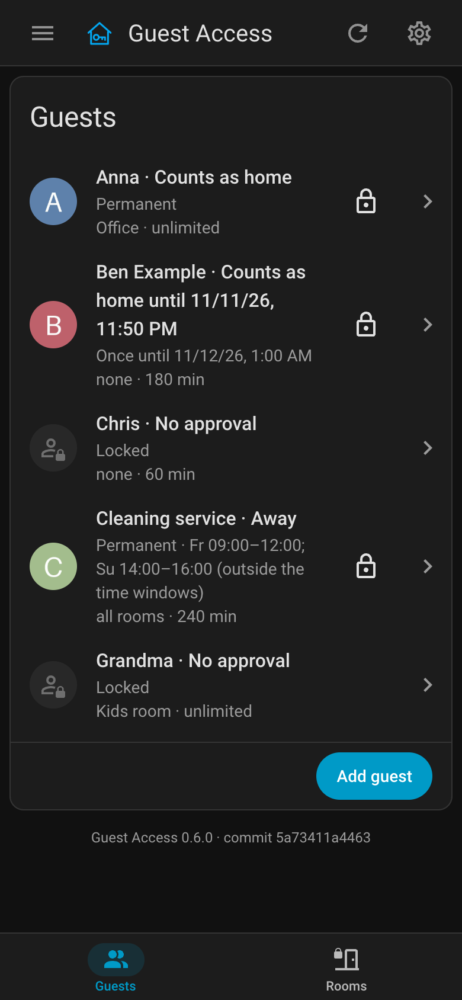
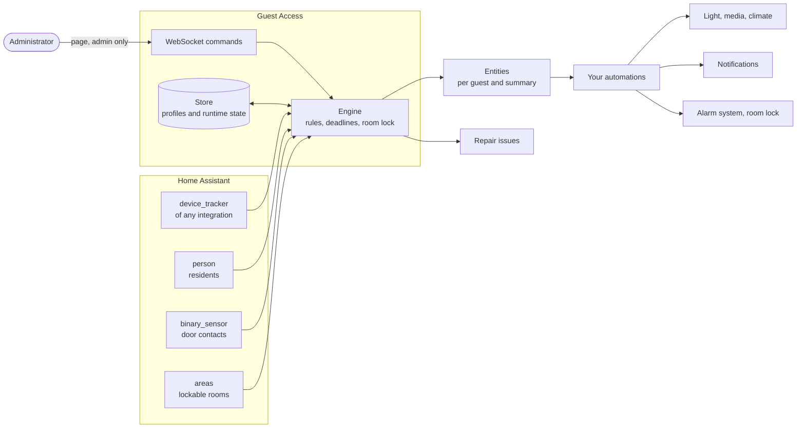
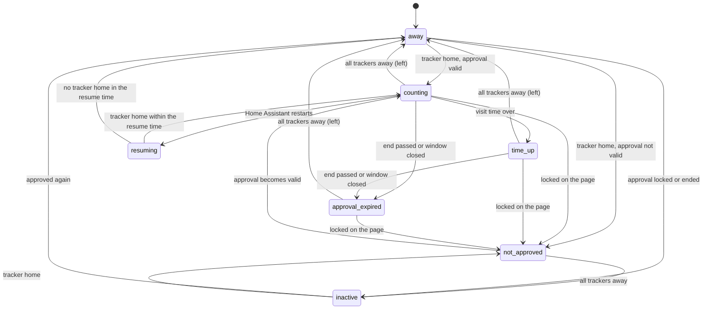
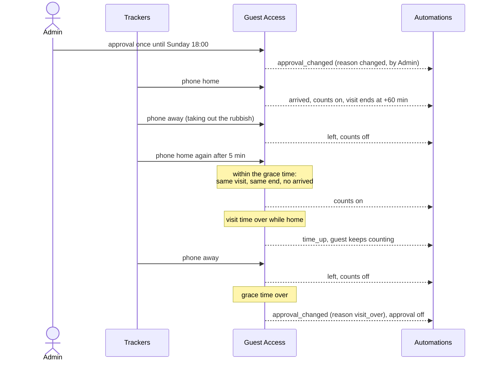
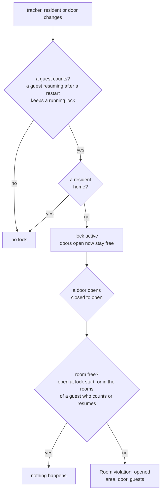

# Guest Access

[](#installation)

A Home Assistant integration to manage guests without making them persons in Home Assistant. Each guest has a profile: any number of trackers, an approval with a validity and optional time windows, the rooms the guest may enter, the time per visit and, if wanted, a visit log. Guest Access tells Home Assistant which guests count as home, whether only guests are home and what happens to each guest; your automations decide what follows, from greeting a guest with light to an alarm system that treats approved guests like residents.

Guests are managed on a page in the sidebar, for administrators only. No entity can change an approval.

What it is for, for example:

- the cleaner counts as home on Tuesdays from 9 to 12, and a visit log keeps the hours;
- grandparents have a permanent approval, a friend one for this weekend only;
- a dashboard shows who is visiting, with photo and since when, next to the residents;
- lights greet a guest, and the TV stays off while only guests are home;
- an alarm system treats approved guests like residents, and a door to a room that is off limits raises an event.

## Screenshots

The guests with their state and approval, made up for these pictures:



A guest's form: a key tag as tracker, photo and note, the approval with two weekly time windows:



The visit log of a guest, on a 15-minute grid, with monthly totals and a CSV export:



The list at phone width in dark mode:



## Design

### Overview



Guest Access reads trackers, residents and door contacts and decides; everything to the right of the entities is up to your automations, not part of the integration. Nothing is polled: Guest Access follows the state changes of these entities and wakes at its own deadlines (visit end, end of an approval, a time window opening or closing, the grace time), so its entities change the moment something happens.

### Guests

A guest is a profile with:

| Field | Meaning |
|---|---|
| Name | up to 100 characters; shown on the page and in events |
| Trackers | one or more `device_tracker` entities of any integration (a Bluetooth beacon, a phone on Wi-Fi); the guest is home when one of them is `home`; `unknown` and `unavailable` never count |
| Approval | `off`, `once until <datetime>`, `permanent until <datetime>`, `permanent` |
| Time windows | optional for permanent approvals (with or without an end): any number of windows, each weekdays and a time range; the approval applies within any of them, e.g. Mon–Fri 08:00–18:00 and Sat 10:00–14:00 |
| Grace time | how long all trackers may be away and the visit still goes on when one returns; for a once approval also when it ends (default 15 min) |
| Rooms | the lockable rooms (see Room lock) the guest may enter on top of the unlockable ones, or everything |
| Time per visit | 1 to 1440 minutes (default 60) or unlimited, counted from the arrival that starts the visit |
| Visit log | off by default; see Visit log |
| Photo | optional, uploaded on the page into Home Assistant's images like a person's picture; shown by the guest's counts and status entities and in `guest_list`, so dashboards show the guest as they show a person |
| Note | optional, up to 2000 characters, for administrators: shown on the page only, in no entity |

### When a guest counts

A guest counts while all of these hold:

1. the approval is not `off` and its end, if any, has not passed,
2. the time window, if any, contains the current time,
3. one of the guest's trackers is `home`.

When no tracker is home any more, the guest stops counting at once (`left`). A return within the grace time continues the same visit: its end stays, no new `arrived` is raised. A return later is a new visit with a new end. Locking the guest or an approval that is no longer valid ends the visit as well; so does any change of the approval while the guest is away, the visit ending when the guest left.

A `once` approval is one visit: when no tracker of the guest has been home for the grace time, the approval switches to `off`. A guest who returns later needs a new approval.

The status sensor of a guest follows these rules:



`away` is an approved guest who is not home, including the grace time: the guest does not count, but a return within it continues the visit. `inactive` is a guest without an approval (locked, or its end has passed) who is not home. A visit with a `once` approval, step by step:



### Several guests

If only guests are home, their rooms add up, because an opened door cannot be told apart by guest: the free rooms are the union of the rooms of all guests who count. Time is per guest.

### Expiry while the guest is home

When the visit time of a guest runs out, or the approval ends (its end passes or its time window closes) while the guest is home, the guest keeps counting until they leave or are locked, and the guest's event entity fires `time_up` or `approval_expired`.

### Room lock

Rooms are set once on the page: each lockable room is a Home Assistant area with exactly one door contact (`binary_sensor`), so names follow the area registry. A room that stops being lockable is removed from every guest. The lock starts when guests count and no resident is home, given as a list of `person` entities on the page. A room is locked while its door is closed, and an opening is a change to open from the last known real state closed (a door opened while its contact was unavailable counts once the contact reports; a contact that returns to a door already open before does not); guests waiting to resume after a restart keep their rooms free unless they were locked; a room whose door is open when the lock starts stays free for that visit. The lock ends when a resident comes home or no guest counts any more.



### What Home Assistant gets

Each guest is a device with its entities.

| Kind | Entity | Purpose |
|---|---|---|
| Per guest | `binary_sensor` "<guest> counts" (presence), with the guest's photo as its picture | automations, the guest's state on dashboards |
| Per guest | `sensor` "<guest> status" (enum: `counting`, `time_up`, `approval_expired`, `not_approved`, `resuming`, `away`, `inactive`), with the guest's photo as its picture | dashboards show it as it is, no template; `inactive` (no approval and not home) lets them leave such guests out |
| Per guest | `sensor` "<guest> visit ends" (timestamp; unknown while the guest does not count or the time is unlimited) | dashboards, time triggers |
| Per guest | `sensor` "<guest> hours this month" (hours of the finished visits this month from the visit log; unknown without a log; disabled by default, see Privacy) | the hours on a dashboard |
| Per guest | `event` "<guest> activity" with the types `arrived`, `left`, `time_up`, `approval_expired`, `approval_changed` (with `reason` `changed` or `visit_over`, and `by`: the administrator who changed it; the logbook names that user too) | push and log stay in automations |
| Only guests | `binary_sensor` "Only guests home" (on while guests count and no resident is home) | anything that should behave differently when guests are alone |
| Summary | `binary_sensor` "Guests home" (presence) with attributes: guests who count, free rooms, locked rooms, and `guest_list` (every guest but inactive ones, by name: `name`, `picture`, `status`, `status_entity`, `visit_ends` while the guest counts with time left or time up) | the one entity automations read to treat guests as home; `guest_list` lets a dashboard list the guests without searching the entity registry |
| Summary | `sensor` "Guests home since" (timestamp: the earliest arrival of the guests who count; unknown while none counts; a restart or a return within the grace time does not move it) | dashboards showing since when guests are home |
| Room lock | `event` "Room violation" with the type `opened`, carrying the area, the door and the guests who count | push, log and image series stay in automations |

A new guest's entities get the IDs `guest_<name>_<entity name>`, in the language of Home Assistant, so a guest's entities stand together; renaming a guest later keeps the IDs.

The integration only provides state and triggers; it notifies nobody and switches nothing. Every reaction (turning on lights on arrival, keeping the TV off while only guests are home, an alarm system that counts approved guests as home) is an automation that uses state triggers on these entities. No template is needed for that.

No entity changes an approval: Home Assistant cannot limit an entity to administrators, so approvals are changed only on the page.

### Visit log

For guests whose hours matter (a cleaner, a babysitter) Guest Access can keep a visit log, not a surveillance record. It is off by default and switched on per guest; switched off, the log kept so far is deleted. Each finished visit is logged with its date, start and length, both on a grid (default 15 minutes) counted from local midnight; a return within the grace time is the same visit, while a change of the approval ends a visit whose guest is away. Rooms, doors, places and overruns are not logged. Single visits are kept for 90 days and monthly totals (visits, hours) for 13 months by default. The log shows only on the page, with a CSV export and a delete button; the sensor "<guest> hours this month" carries the hours of the finished visits this month.

### Settings

On the page, tab "Rooms", "Edit":

| Setting | Default | Meaning |
|---|---|---|
| Residents | none | `person` entities; the room lock applies while none of them is home |
| Lockable rooms | none | areas, each with exactly one door contact |
| Resume time | 10 min | after a restart, how long a guest who counted may take to be seen again and continue the visit |
| Grid of the visit log | 15 min | start and length of a logged visit are rounded to it |
| Keep single visits | 90 days | then a visit is deleted, its monthly total stays |
| Keep monthly totals | 13 months | then the total is deleted |

### Privacy

Guest Access stores only the profiles with their notes, the visit in progress, for guests with a visit log the rounded visits, and which images in Home Assistant are guests' photos. It writes nothing about guests to the Home Assistant log.

- The names, rooms, guest list and administrator in the attributes of "Guests home", the room violation and the guests' events are not recorded in the history.
- A guest's photo is stored and served by Home Assistant like the picture of a person: every user sees it on dashboards, and Home Assistant hands it out without a login to whoever knows its address, which contains a random ID. Because of that Guest Access stores a photo without its metadata (where and when it was taken, the device), at most 1024 pixels wide and high and without its file name. Guest Access deletes only the photos uploaded through it: a replaced or removed photo, the photo of a deleted guest, an upload never saved with a guest (after a day) and all of them when the integration is removed; an image of a person or an area is never taken as a guest's photo nor deleted. The photo's address is not recorded in the history. Leave the photo out if that is too much.
- A guest's note stays on the page; it is in no entity, attribute, history or diagnostics, only in the store (and so in backups).
- The sensor "<guest> hours this month" is disabled when it is created: every user can read an entity, while the visit log is meant for administrators. Enable it where you need the hours.
- Home Assistant still records the state of each guest's entities (counts, status, events) to the minute for as long as your recorder keeps history. If the history should not hold more than the visit log, exclude the guests' entities from the recorder, for example:

  ```yaml
  recorder:
    exclude:
      entity_globs:
        - binary_sensor.guest_*_counts
        - sensor.guest_*_status
        - sensor.guest_*_visit_ends
        - event.guest_*_activity
  ```

  The endings follow the language of Home Assistant (in German `_zahlt`, `_status`, `_besuchsende`, `_aktivitat`). The summary entities (`guest_access_*`) stay recorded, for automations or dashboards that use their history. Exclude the trackers of guests too if their integration records more than home or away, for example a room.

### Diagnostics

**Settings → Devices & services → Guest Access → ⋮ → Download diagnostics** gives the settings, every guest with status, approval, rooms and visit state, whether it has a photo and a note (not what they show or say), the state of each tracker, resident and door, and the open repair kinds. Names, entity IDs and areas are replaced by placeholders (Guest 1, Room 1), times by minutes from now and the visit log by its size, so the file can be attached to an issue as it is.

### Repairs

Once Home Assistant has started, Guest Access opens a repair issue for every tracker, resident or door contact that is neither registered nor has a state, and for every lockable room whose area is gone; doors and areas as errors, because the room lock cannot see them. An issue closes by itself when the entity or area is back or no longer used.

### Page

A sidebar page for administrators only, in English and German, with two tabs: "Guests" lists the guests with photo and state, a "lock now" button that sets the approval to `off`, and "Add guest"; "Rooms" shows the residents, the lockable rooms and whether the room lock is on, with "Edit" for residents, rooms and timings. A guest opens as a subpage with a back arrow: trackers, photo and note, approval and time windows, rooms and time, visit log. The tab is in the URL (`/guest-access/guests`, `/guest-access/rooms`), so a reload and the browser's back button keep it. At the bottom: the version and, when deployed with `scripts/deploy.sh`, the commit.

The header is one row, as on Nico's other apps and integrations: the integration's icon, its name and the tabs, then when the page last got its data ("As of 14:52:40", hidden at phone width), a refresh button that fetches the data again without reloading the page, and a settings button to Home Assistant's page of the integration. At phone width the tabs move to the bottom of the screen. A subpage shows the back arrow and its title in place of icon, name and tabs. Non-administrators get no page.

### State

Profiles and the runtime state (approval, last time a tracker was home, deadlines, lock) live in the integration's store, photos in Home Assistant's images, so a restart neither loses nor extends anything. After a restart a guest counts again only once a tracker reports `home`; when that happens within the resume time, the visit goes on with its end and without a new `arrived`, otherwise the guest has left.

## Examples

Guests count as home wherever "someone home" matters, without a template: put "Guests home" next to the residents, for example in a group.

```yaml
group:
  anyone_home:
    name: Anyone home
    entities:
      - person.sam
      - person.robin
      - binary_sensor.guest_access_guests_home
```

A notification when a guest's time is up while the guest is still there:

```yaml
automation:
  - alias: Guest time up
    triggers:
      - trigger: event.received
        target:
          entity_id: event.guest_anna_activity
        options:
          event_type: [time_up]
    actions:
      - action: notify.mobile_app_sams_phone
        data:
          message: "Anna's visit time is up."
```

Keep the TV off while only guests are home:

```yaml
automation:
  - alias: TV off while only guests are home
    triggers:
      - trigger: state
        entity_id: binary_sensor.guest_access_only_guests_home
        to: "on"
    actions:
      - action: switch.turn_off
        target:
          entity_id: switch.tv_plug
```

A room violation, with the room and the guests who count:

```yaml
automation:
  - alias: Guest opened a locked room
    triggers:
      - trigger: event.received
        target:
          entity_id: event.guest_access_room_violation
        options:
          event_type: [opened]
    actions:
      - action: notify.mobile_app_sams_phone
        data:
          message: >-
            {{ trigger.to_state.attributes.guests | join(', ') }} opened
            {{ trigger.to_state.attributes.area }}.
```

## Known limitations

- A tracker with a valid approval is a key: wherever Guest Access counts guests as residents, for example in an alarm system, carrying the tracker is enough. A Bluetooth beacon can be imitated with its address. Keep approvals as narrow as possible (an end, time windows) and lock a lost tracker at once.
- Guest Access knows trackers, not people: a guest who stays while the tracker leaves no longer counts, and neither does a guest whose tracker loses reception; a return within the grace time continues the visit.
- After a restart, guests count again only once a tracker reports home.
- Rooms are locked by their door contact only: a room without a door contact cannot be locked, and windows are not watched.
- Only administrators see the page and change approvals; Home Assistant cannot limit entities or actions to administrators, so there is no entity or action for it.

## Troubleshooting

- **A guest does not count:** the status sensor says why: `not_approved` (approval off, ended or outside its time windows), `away` (no tracker home; `unknown` and `unavailable` never count), `resuming` (waiting for a tracker after a restart).
- **A repair issue names a tracker, resident, door or area:** it was removed or renamed; choose the new one on the page.
- **The page is missing:** it is shown to administrators only, after the integration is set up.
- **Saving says "no photo uploaded through Guest Access":** the photo was chosen more than a day ago without saving, or deleted meanwhile; choose it again.
- **Something else:** download the diagnostics (see Diagnostics) and attach them to an issue; they contain no names, entities or areas.

## Interface

Automations, dashboards and scripts build on what this section lists. From 1.0.0 on it changes only with a new major version: a later minor version may add entities, attributes, event types, event data, status values or optional command parameters, but renames, removals and changed meanings wait for the next major version and are listed in the changelog. Before 1.0.0 it may still change between minor versions. `tests/test_contract.py` pins all of it.

Times are ISO 8601 with offset, to the second. Guest names in attributes and event data are the name of the guest's device, so a name given to the device in Home Assistant wins over the name on the page.

### Entities

IDs as created in English; Home Assistant takes the entity name in its own language for new IDs (in German `binary_sensor.guest_anna_zahlt`). Renaming keeps an ID. The unique IDs do not change: `<entry>` is the config entry, `<guest>` the guest's ID (32 hex digits, also the device identifier `(guest_access, <guest>)`).

| Entity ID | Unique ID | State |
|---|---|---|
| `binary_sensor.guest_access_guests_home` | `<entry>_guests_home` | `on` while any guest counts |
| `binary_sensor.guest_access_only_guests_home` | `<entry>_only_guests_home` | `on` while guests count and no resident is home |
| `sensor.guest_access_guests_home_since` | `<entry>_guests_home_since` | earliest arrival of the guests who count, else unknown |
| `event.guest_access_room_violation` | `<entry>_room_violation` | event type `opened` |
| `binary_sensor.guest_<name>_counts` | `<guest>_counts` | `on` while the guest counts; `entity_picture`: the guest's photo |
| `sensor.guest_<name>_status` | `<guest>_status` | `counting`, `time_up`, `approval_expired`, `not_approved`, `resuming`, `away`, `inactive`; `entity_picture`: the guest's photo |
| `sensor.guest_<name>_visit_ends` | `<guest>_visit_ends` | end of the visit while the guest counts with a time per visit, else unknown |
| `sensor.guest_<name>_hours_this_month` | `<guest>_month_hours` | hours of the finished visits this month; unknown without a visit log; disabled by default |
| `event.guest_<name>_activity` | `<guest>_activity` | event types below |

### Events

| Entity | Event type | Data |
|---|---|---|
| guest | `arrived` | `visit_ends`: end of the visit, `null` when unlimited |
| guest | `left` | none |
| guest | `time_up` | `visit_ends` |
| guest | `approval_expired` | `kind`, `until`, `windows`: the approval that no longer applies |
| guest | `approval_changed` | `kind`, `until`, `windows`: the new approval; `reason`: `changed` (by an administrator) or `visit_over` (a once approval after its visit); `by`: name of the administrator, `null` for `visit_over` |
| room violation | `opened` | `area_id`, `area` (name), `door` (entity ID), `guests`: names of the guests who count |

`kind` is `off`, `once`, `until` or `permanent`; `until` a time or `null`; `windows` a list of `{"weekdays": [0–6, Monday 0], "start": "HH:MM", "end": "HH:MM"}` in local time, an end before the start reaching past midnight. A change by an administrator carries that user's context, so the logbook names them.

### Attributes of "Guests home"

| Attribute | Value |
|---|---|
| `guests` | names of the guests who count |
| `free_rooms`, `locked_rooms` | names of the lockable rooms that are free or locked right now |
| `guest_list` | every guest but inactive ones, sorted by name: `name`, `picture` (address of the photo or `null`), `status` (as the status sensor), `status_entity` (its entity ID), `visit_ends` (while the guest counts with time left or time up, else `null`) |

### WebSocket commands

For administrators only; the page uses them, and so can a script with an administrator's token.

| Command | Parameters |
|---|---|
| `guest_access/subscribe` | none; sends the page's data now and after every change. Its content serves the page and is not part of this interface |
| `guest_access/save_guest` | `guest_id` (to change a guest, left out for a new one), `name`, `trackers`, `approval` (`kind`, `until`, `windows`), `rooms`, `all_rooms`, `visit_minutes` (1–1440 or `null`), `grace_minutes` (1–240), `log_visits`, `picture` (ID from the photo upload below, or `null` to remove it), `note`; left out, `picture` and `note` keep their value; returns `guest_id` |
| `guest_access/lock_guest` | `guest_id`; sets the approval to `off` |
| `guest_access/delete_guest` | `guest_id`; removes the guest with its device and visit log |
| `guest_access/delete_visits` | `guest_id`; deletes the guest's visit log |
| `guest_access/save_settings` | `residents`, `rooms` (`area_id`, `door`), optionally `resume_minutes`, `log_grid_minutes`, `log_keep_days`, `log_keep_months` |

### Photo upload

`POST /api/guest_access/picture` with a multipart field `file` (PNG, JPEG or GIF), for administrators only, stores the image in Home Assistant's images and answers `{"id": "<image ID>"}`. Only such an ID is accepted as a guest's `picture`; an upload not saved with a guest within a day is deleted. The image is not stored as it comes: it is encoded anew without its metadata, made at most 1024 pixels wide and high, and stored under a fixed file name. An image of more than 40 megapixels is refused.

### Store

`.storage/guest_access`, version 1, holds the settings, the guests, their runtime state, the room lock, the visit log and the IDs of the guests' photos. A new version comes with a migration from the one before; Home Assistant backups include the file.

## Installation

1. **Settings → Marketplace → Add from link** (top right), enter `https://github.com/n-schilling/ha-guest-access` as GitHub link and add it. Adding a repository by link asks you to connect GitHub once.
2. Install **Guest Access** in the Marketplace and restart Home Assistant.
3. **Settings → Devices & services → Add integration → Guest Access.**
4. Open **Guest Access** in the sidebar, set residents and rooms, and add the first guest.

Requires Home Assistant 2026.11 or later. Without the Marketplace, copy `custom_components/guest_access` into the `custom_components` folder of your configuration directory and restart. There are no requirements outside Home Assistant.

### Removal

**Settings → Devices & services → Guest Access → ⋮ → Delete** removes the guests, their devices and entities, the visit log and the page. Then remove the integration in the Marketplace and restart.

## Development

```bash
uv venv --python 3.14 && uv pip install -r requirements_test.txt
scripts/check.sh
```

`scripts/check.sh` runs what CI runs: ruff, the changelog and translation checks, mypy, the tests with their coverage threshold, the page checks and hassfest in Docker. The page check is not part of CI: run `scripts/check.sh` before a release that changes the page.

The page checks start a throwaway Home Assistant with made-up guests, reachable from this machine only, drive the page in a headless browser (header with icon and tabs, the tab in the URL, list, form, visit log, lock, rename, photo and note, errors, phone width, dark mode, no page for non-administrators) and stop Home Assistant again. They need their own environment:

```bash
uv venv --python 3.14 .venv-panel && uv pip install --python .venv-panel/bin/python -r requirements_panel.txt
```

They use an installed Google Chrome, otherwise Playwright's Chromium (`.venv-panel/bin/python -m playwright install chromium`). The pictures in this README come from the same run:

```bash
.venv-panel/bin/python -I scripts/panel/check_panel.py --screenshots docs/screenshots
```

Releases: CI runs on `dev`; once it is green, push that commit to `main`. CI does not run again there: the release workflow checks that CI passed for the commit, then tags the version from `manifest.json` and publishes a GitHub release with its CHANGELOG section; the Marketplace offers it as an update.

For testing on a Home Assistant OS host before a release (copies the files, writes the deployed commit for the page and restarts Home Assistant):

```bash
scripts/deploy.sh <ssh-host>
```

The page shows the version and that commit at the bottom; `-dirty` marks files that differ from it.

## License

Apache License 2.0, see [LICENSE](LICENSE).
