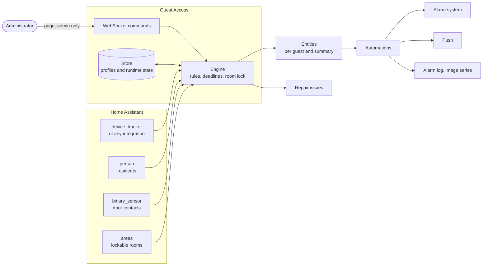
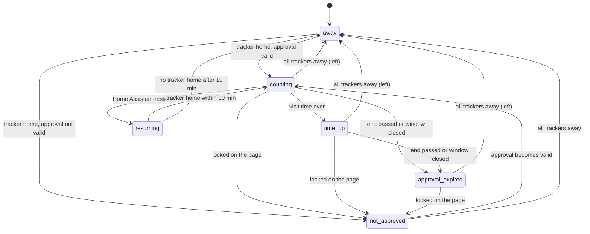
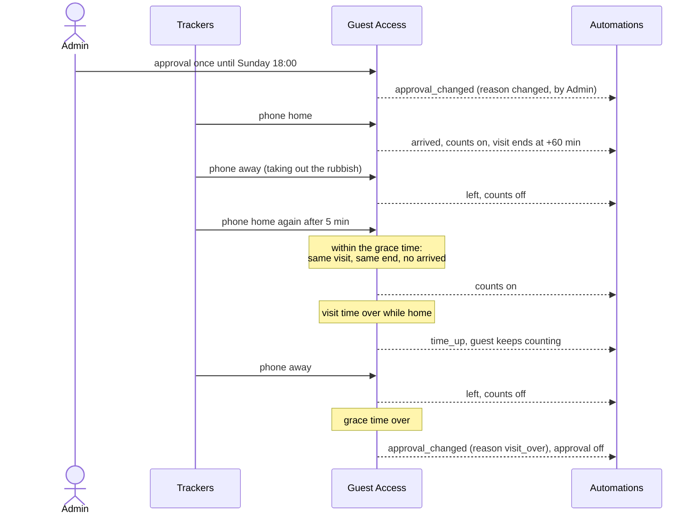
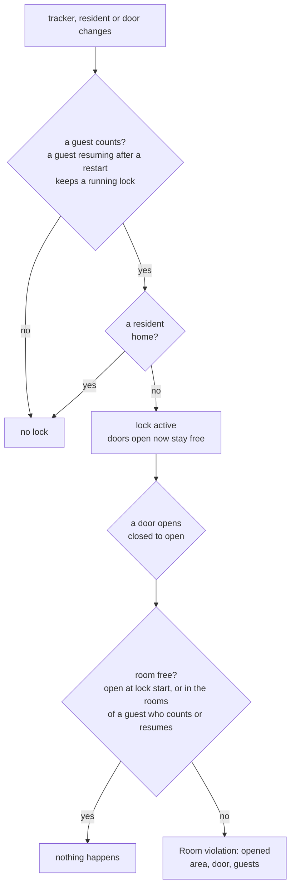

# Guest Access

A Home Assistant integration that decides which guests count as present for an alarm system: one profile per guest with any number of trackers, an approval with a validity, optionally a time window, the rooms the guest may enter and the time per visit.


Status: 0.1.0 in development, not deployed yet.

## Design

### Overview



Guest Access reads trackers, residents and door contacts and decides; everything to the right of the entities is an automation of the installation, not part of the integration.

### Guests

A guest is a profile with:

| Field | Meaning |
|---|---|
| Name | shown on the page and in events |
| Trackers | one or more `device_tracker` entities of any integration (a Bluetooth beacon, a phone on Wi-Fi); the guest is home when one of them is `home`; `unknown` and `unavailable` never count |
| Approval | `off`, `once until <datetime>`, `permanent until <datetime>`, `permanent` |
| Time windows | optional for permanent approvals (with or without an end): any number of windows, each weekdays and a time range; the approval applies within any of them, e.g. Mon–Fri 08:00–18:00 and Sat 10:00–14:00 |
| Grace time | how long all trackers may be away and the visit still goes on when one returns; for a once approval also when it ends (default 15 min) |
| Rooms | the lockable rooms (see Room lock) the guest may enter on top of the unlockable ones, or everything |
| Time per visit | 30, 60 (default) or 120 minutes or unlimited, counted from the arrival that starts the visit |

### When a guest counts

A guest counts while all of these hold:

1. the approval is not `off` and its end, if any, has not passed,
2. the time window, if any, contains the current time,
3. one of the guest's trackers is `home`.

When no tracker is home any more, the guest stops counting at once (`left`). A return within the grace time continues the same visit: its end stays, no new `arrived` is raised. A return later is a new visit with a new end. Locking the guest or an approval that is no longer valid ends the visit as well.

A `once` approval is one visit: when no tracker of the guest has been home for the grace time, the approval switches to `off`. A guest who returns later needs a new approval.

The status sensor of a guest follows these rules:



`away` includes the grace time: the guest does not count, but a return within it continues the visit. A visit with a `once` approval, step by step:



### Several guests

If only guests are home, their rooms add up, because an opened door cannot be told apart by guest: the free rooms are the union of the rooms of all guests who count. Time is per guest.

### Expiry while the guest is home

When the visit time of a guest runs out, or the approval ends (its end passes or its time window closes) while the guest is home, the guest keeps counting until they leave or are locked, and the guest's event entity fires `time_up` or `approval_expired`.

### Room lock

Rooms are configured once on the entry: each lockable room is a Home Assistant area with exactly one door contact (`binary_sensor`), so names follow the area registry. A room that stops being lockable is removed from every guest. The lock starts when guests count and no resident is home, given as a list of `person` entities on the entry. A room is locked while its door is closed, and an opening is a change to open from the last known real state closed (a door opened while its contact was unavailable counts once the contact reports; a contact that returns to a door already open before does not); guests waiting to resume after a restart keep their rooms free unless they were locked; a room whose door is open when the lock starts stays free for that visit. The lock ends when a resident comes home or no guest counts any more.



### What Home Assistant gets

Each guest is a device with its entities.

| Kind | Entity | Purpose |
|---|---|---|
| Per guest | `binary_sensor` "<guest> counts" (presence) | automations, the guest's state on dashboards |
| Per guest | `sensor` "<guest> status" (enum: `counting`, `time_up`, `approval_expired`, `not_approved`, `resuming`, `away`) | dashboards show it as it is, no template |
| Per guest | `sensor` "<guest> visit ends" (timestamp; unknown while the guest does not count or the time is unlimited) | dashboards, time triggers |
| Per guest | `event` "<guest>" with the types `arrived`, `left`, `time_up`, `approval_expired`, `approval_changed` (with `reason` `changed` or `visit_over`, and `by`: the administrator who changed it; the logbook names that user too) | push and log stay in automations |
| Only guests | `binary_sensor` "Only guests home" (on while guests count and no resident is home) | anything that should behave differently when guests are alone |
| Summary | `binary_sensor` "Guests home" (presence) with attributes: guests who count, free rooms, locked rooms | alarm automations read only this |
| Room lock | `event` "Room violation" with the type `opened`, carrying the area, the door and the guests who count | push, log and image series stay in automations |

The integration only provides state and triggers; it notifies nobody, switches nothing and never arms or disarms. Every reaction, inside the alarm system or elsewhere (keeping the TV off while only guests are home, opening blinds or turning on lights on arrival), is an automation that uses state triggers on these entities. No template is needed for that.

No entity changes an approval: Home Assistant cannot limit an entity to administrators, so approvals are changed only on the page.

### Repairs

Once Home Assistant has started, Guest Access opens a repair issue for every tracker, resident or door contact that is neither registered nor has a state, and for every lockable room whose area is gone; doors and areas as errors, because the room lock cannot see them. An issue closes by itself when the entity or area is back or no longer used.

### Page

A sidebar page for administrators only: the list of guests with their state, a form per guest, a "lock now" button that sets the approval to `off`, and the rooms of the entry. Non-administrators get no page.

### State

Profiles and the runtime state (approval, last time a tracker was home, deadlines, lock) live in the integration's store, so a restart neither loses nor extends anything. After a restart a guest counts again only once a tracker reports `home`; when that happens within ten minutes, the visit goes on with its end and without a new `arrived`, otherwise the guest has left.

## Development

```bash
uv venv --python 3.14 && uv pip install -r requirements_test.txt
scripts/check.sh
```

`scripts/check.sh` runs what CI runs: ruff, the changelog and translation checks, mypy, the tests with their coverage threshold, and hassfest in Docker.

Deploy to a Home Assistant OS host:

```bash
tar -C custom_components --exclude __pycache__ -cf - guest_access | ssh <host> 'tar -C /mnt/data/supervisor/homeassistant/custom_components -xf -'
```

then delete the `._*` files macOS adds and restart Home Assistant.
